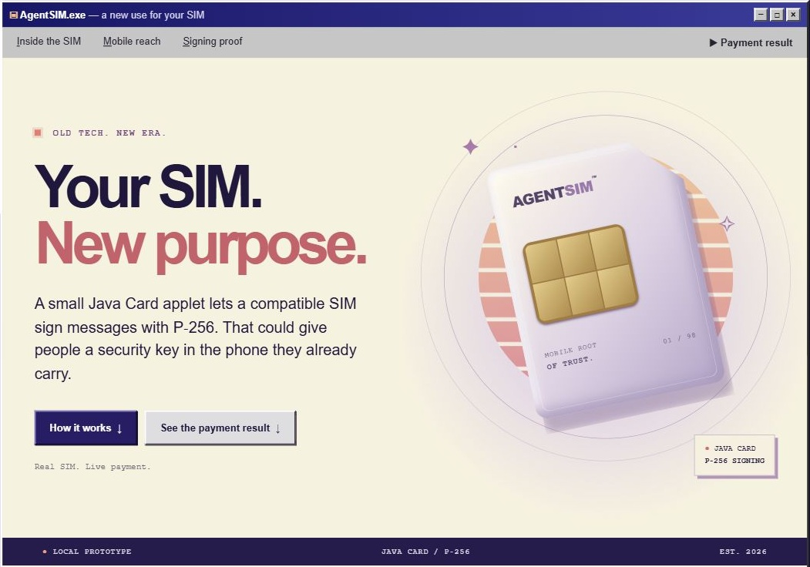
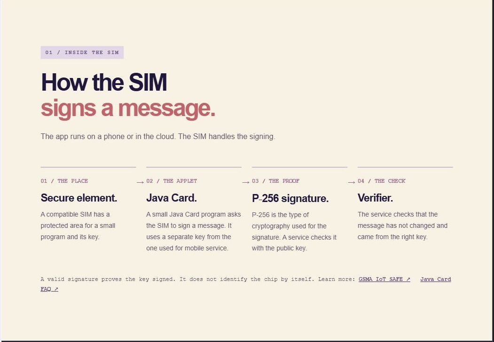
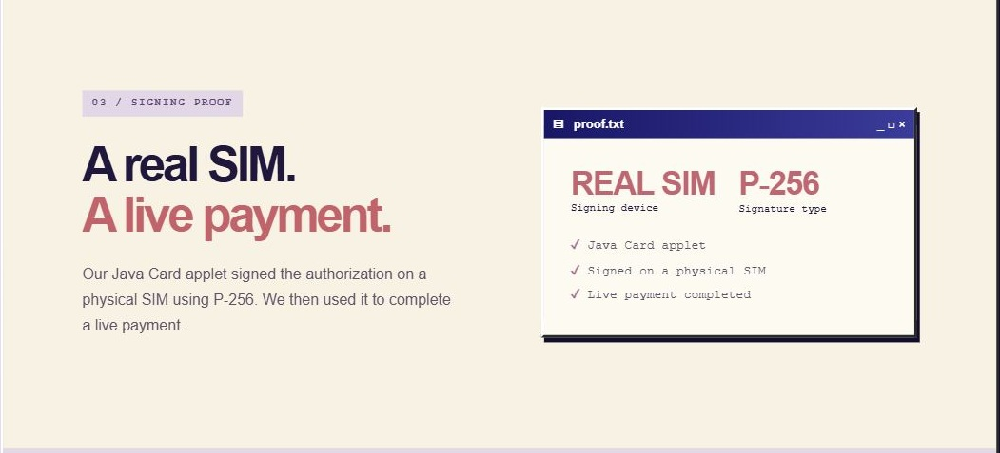

# AgentSIM

We tested P-256 signing on a physical SIM. With AgentSIM, you sign a budget for your personal NEAR AI agent, let it buy compute, and revoke its permission when the job is done.

**Primary track · AI Security & Defense (`security`)**

Suppose an instruction in a supplier’s quote tricks the agent into changing the payment address. Even a correctly signed agent request fails the vault’s recipient check. Changing the approved supplier or raising the budget takes a new P-256 grant from the owner. [Vault implementation](contracts/agentsim-vault/src/lib.rs) · [Demo and tests](src/demo.mjs)

[Visit agentsimnear.xyz](https://agentsimnear.xyz/) · [Live proposal and local payment replay](submission/video/agentsim-live-demo.mp4)

[](https://youtu.be/TdMTaH6908w)

[▶ Watch on YouTube](https://youtu.be/TdMTaH6908w)


## Give an agent a compute budget

Suppose your agent needs compute from one supplier. You approve 150 credits in total and up to 100 per purchase. Its first request for 90 goes through, leaving 60. A request for 101 exceeds the purchase limit. If you revoke the grant, even a request for 10 fails.


## Inside the SIM

The SIM is a small computer with its own processor and protected storage. Our Java Card applet generates the owner’s P-256 key there. After a PIN check, the applet signs the exact grant or revocation with ECDSA and SHA-256. The applet returns the signature while the private key stays on the card.



## How NEAR enforces the budget

NEAR AI proposes an amount and recipient. The Rust vault verifies the owner’s P-256 signature and checks each payment against the signed grant. The agent signs each request with its own Ed25519 key. A second Ed25519 key lets the relayer call only this vault’s `execute` method with zero attached deposit.

In the recorded demo, a live NEAR AI proposal triggered a transfer of **0.001 test NEAR** on a local NEAR network. The Java Card applet ran on the PC for this recording. The transfer callback completed, four forbidden relay actions failed, and the vault rejected both overspending and a payment after revocation.



[Recorded payment proof](evidence/near/2026-11-14-live-near-ai.json) · [Implementation and verification](docs/VERIFICATION.md)

## Why use the SIM already in a phone?

GSMA counts 5.8 billion unique mobile subscribers and 8.8 billion wireless connections. A compatible, provisioned SIM gives that familiar hardware a second use. Our next step is a handset approval screen where the owner can review the recipient and budget before signing. [GSMA Mobile Economy 2026](https://www.gsmaintelligence.com/research/the-mobile-economy-2026)


## Security notes

A leaked agent key still leaves the recipient, budget and expiry fixed by the owner’s signature. The vault checks a nonce on each spend to reject replay. Using the phone’s secure element also removes a separate signing device from the user’s shopping list and supply chain.


## Try the local policy demo

Run `npm run demo` from the repository root with Node.js 22. The local software demo settles 90 test units, then prints `NONCE` for replay, `PER_CALL` for overspending, `RECEIVER` for a changed supplier and `REVOKED` after the owner withdraws permission.

## Verify the recorded payment

```sh
npm ci --prefix tests/near-sandbox
node tests/near-sandbox/verify-restricted.mjs evidence/near/2026-11-14-live-near-ai.json
```

The verifier checks the signed grant, relay actions, transfer outcome and final vault state. On success it prints `Verified restricted key setup, signed messages/actions, recorded node rejection codes, local receipts and policy states.`

Our in-window work added the Java Card applet, PC/SC host, NEAR vault execution, restricted relayer and AI proposal flow. We reused protocol helpers and vectors from the earlier unversioned workspace.

[Run guide](tests/near-sandbox/RESTRICTED.md) · [Source history](docs/handoff/FINDINGS.md) · [In-window changes](https://github.com/Lem0nTree/agentsim-nearhackathon/compare/f89603ed6aa0ff4d68e99896d53c933b43f53471...main) · [MIT License](LICENSE)


