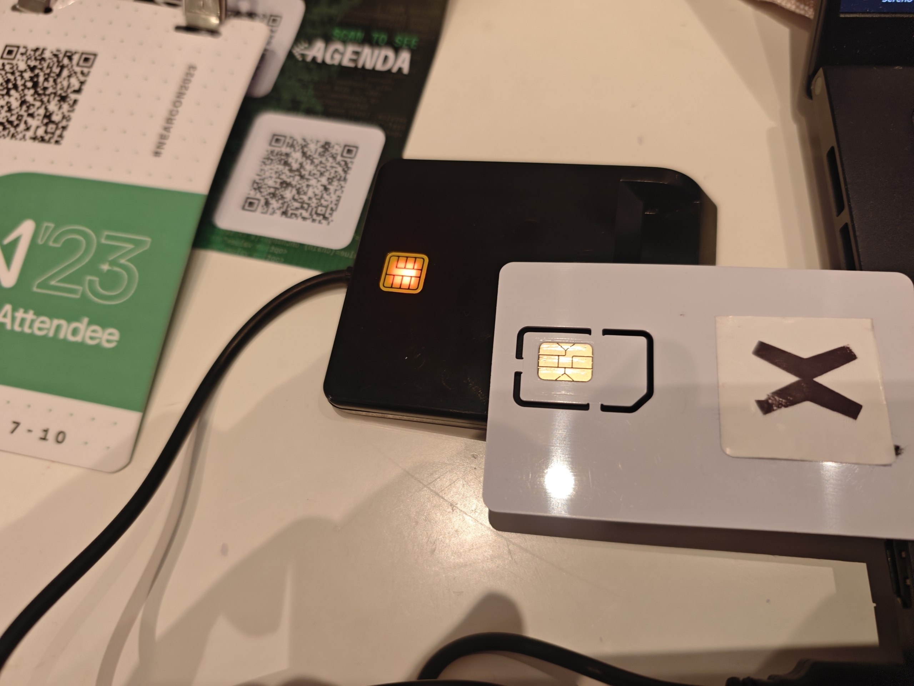
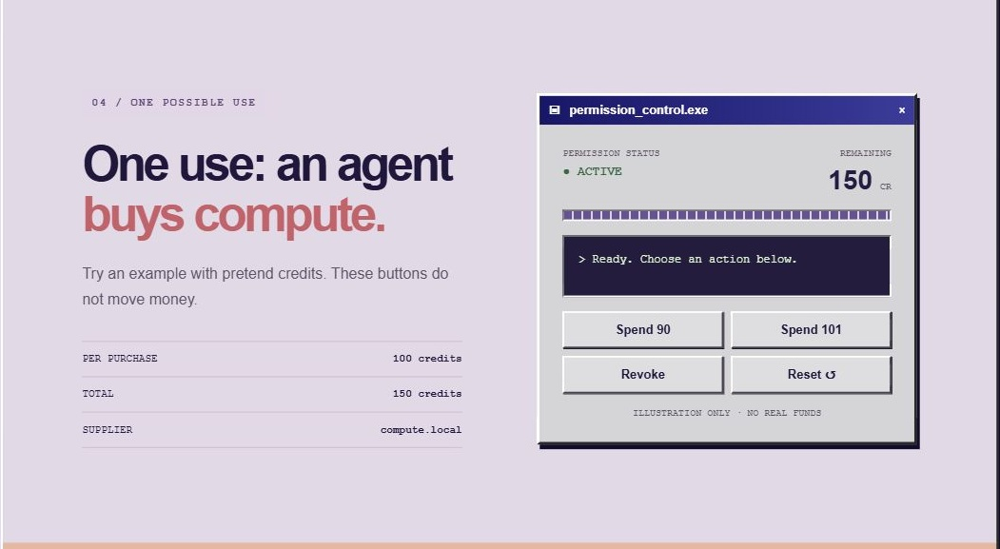

# AgentSIM — NEAR Hackathon

AgentSIM's working Java Card applet uses P-256 elliptic-curve cryptography (ECC) to control what a personal NEAR AI agent can spend. The applet generates the owner's signing key and signs spending grants and revocations. Its APDU interface has no private-key export command. Phone-based control requires a compatible, provisioned SIM or eSIM and authorized phone access, without a separate consumer signing device.

You choose the recipient, per-payment limit, total budget and expiry, and can revoke the grant. The Rust NEAR vault verifies the owner's P-256 permissions. A separate Ed25519 agent session key signs each spend, and an execute-only Ed25519 relayer submits it to the vault. A handset approval interface has not been shipped. Explore the [pitch](submission/pitch.md) and [form draft](submission/project-description.md).

Visit [agentsimnear.xyz](https://agentsimnear.xyz/) · Watch the [Earlier illustrated 30-second overview](submission/video/agentsim-overview-30s.mp4) · See the [owner-supplied physical SIM photo](evidence/hardware/2026-11-14-physical-sim.jpg)

## How the permissions work

A compatible SIM's secure element provides a processor and protected storage for cryptographic keys. Java Card runs an isolated applet that receives APDU commands. In AgentSIM's applet, PIN verification gates signing and the interface returns the public key and signatures. This architecture requires suitable card hardware and provisioning. [Java Card security overview](https://www.oracle.com/java/technologies/java-card/javacard1.html) · [GSMA IoT SAFE](https://www.gsma.com/solutions-and-impact/technologies/internet-of-things/iot-safe/)

The cloud model proposes an amount and recipient. The owner chooses a grant with a recipient, per-payment cap, total budget and expiry. The applet generates a 256-bit EC key, uses ECDSA with SHA-256 for canonical grant and revocation messages, and enforces a three-try PIN. Its APDU interface has no private-key export command. [Java Card FAQ](https://www.oracle.com/java/technologies/java-card/javcard-faq.html) The Rust vault hashes the exact signed message with SHA-256 and uses NEAR's P-256 verification to check the owner's authority. The grant binds the chain, vault, epoch, agent, separate Ed25519 session key, recipient, limits and expiry. A signed control message binds its operation and nonce to the same chain, vault and epoch.

The agent signs each spend with that session key. The vault verifies the Ed25519 signature and checks the recipient, amount, total, expiry, nonce and revocation before a transfer. A separate finite-allowance relayer key is limited to the vault's `execute` method with zero deposit. Revocation blocks future authorized spends. These boundaries let the model propose a payment without giving it the owner's signing key or control of the grant limits. The design uses a compatible, provisioned SIM and authorized phone access, so it does not require a separate consumer signing device. See the [vault implementation](contracts/agentsim-vault/src/lib.rs) and [NEAR access-key documentation](https://docs.near.org/protocol/accounts-contracts/access-keys).

## Implementation and verification

**Applet status: working.** On November 14, 2026, the project owner confirmed a physical SIM signing test worked with P-256 ECC. The [owner clarification](evidence/hardware/2026-11-14-owner-p256-confirmation.json) records that report; the photo shows the owner-supplied physical card setup. In the recorded run, the product applet signed a grant and revocation in a PC Java Card simulator. A live NEAR AI response supplied the amount and recipient for a controlled local NEAR run in which the vault verified those permissions, transferred 0.001 test NEAR and completed its callback. The node denied four forbidden relay actions, and the vault denied overspending and spending after revocation. See the [verification guide](docs/VERIFICATION.md) for the separate card diagnostic, execution environments, provider result and commands. The [live-run proof](evidence/near/2026-11-14-live-near-ai.json) records the proposal and local outcomes; the [72-second live replay](submission/video/agentsim-live-demo.mp4) is accompanied by a [submission guide](submission/RELEASE.md) and review package.

## Website walkthrough

The following images are sections of [agentsimnear.xyz](https://agentsimnear.xyz/), shown in their original order.

**1. The idea:** A compatible SIM can give the owner a signing key for agent permissions.

**2. How it works:** A Java Card applet signs with P-256 and a verifier checks the message and public key.

**3. Mobile reach:** The mobile-industry figures provide context; compatible cards and authorized provisioning are required.

**4. Signing and payment:** The project owner reports a physical-SIM P-256 signing test. The recorded local NEAR payment used the applet in a PC simulator; the available records do not link that payment to the reported physical test.

**5. Spending example:** The site illustrates permission limits using pretend credits; its buttons do not move money.

**6. Security bulletin:** The site highlights reported incidents as background for considering key and supply-chain security.

**7. Project links:** The closing section brings the SIM, mobile reach and signing sections together.

## Why a phone-scale approach?

G+D dates the first commercial SIM to 1991. GSMA's 2026 report describes 8.8 billion wireless connections and 5.8 billion unique subscribers. These are mobile-industry figures, not counts of compatible cards or AgentSIM deployments. Android documents carrier-privileged UICC access as one possible route; operator-granted access and compatible provisioning would still be required. [Android UICC privileges](https://source.android.com/docs/core/connect/uicc) · [G+D SIM history](https://www.gi-de.com/en/group/press/press-releases/30-years-of-sim-a-fascinating-success-story) · [GSMA Mobile Economy 2026](https://www.gsmaintelligence.com/research/the-mobile-economy-2026)

## Security notes

SIMs have a long mobile security history, and [GSMA IoT SAFE](https://www.gsma.com/solutions-and-impact/technologies/internet-of-things/iot-safe/) describes a SIM-based root of trust for IoT devices. This precedent does not establish AgentSIM compatibility or certification. Independent researchers reported deficiencies in a specific eSIM implementation and test profile, so individual cards, provisioning and phone access require evaluation. [Security Explorations research](https://www.security-explorations.com/esim-security)

The local contract operator retains administrative authority. A trustworthy approval interface, secure provisioning and independent security review remain open. Any future identity link would be optional, consent-based and require an appropriate operator; a signature alone does not establish identity or KYC.

The [product applet PC test guide](tests/java-card/README.md) describes the public simulator and transport tests. The original video-emulator workspace is kept locally and is excluded from the repository.

## Development history

The [first in-window import and subsequent changes](https://github.com/Lem0nTree/agentsim-nearhackathon/compare/f89603ed6aa0ff4d68e99896d53c933b43f53471...main) show the tracked repository work. The earlier unversioned AgentSIM workspace supplied protocol helpers and vectors; see the [source and provenance index](docs/handoff/FINDINGS.md).

## License

AgentSIM is available under the [MIT License](LICENSE).
