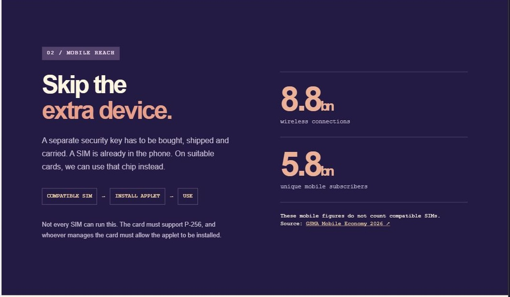
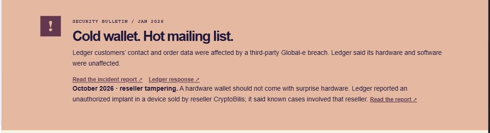
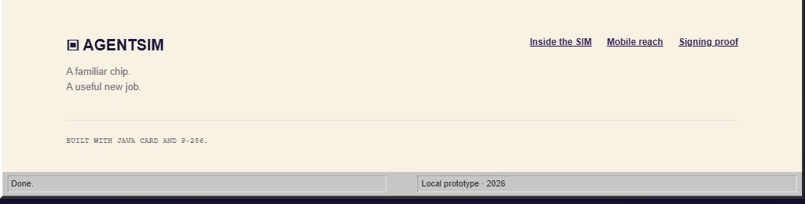

# AgentSIM

[](https://github.com/Lem0nTree/agentsim-nearhackathon/actions/workflows/check.yml)  

AgentSIM lets a personal NEAR AI agent spend a budget you signed for, and nothing more. The owner's authority is a PIN-gated P-256 key on a SIM; the agent's own key can only spend inside the signed recipient, per-call limit, total and expiry.

The November 15 payment was signed by the physical SIM over PC/SC. The record stores the applet AID, the pinned key and the PC/SC transport. The same applet source runs in an emulator, so the whole flow reproduces without a reader.

**Primary track · AI Security & Defense (`security`)**

## Check it in 60 seconds

```sh
npm ci --prefix tests/near-sandbox
npm test
node tests/near-sandbox/verify-restricted.mjs evidence/near/2026-11-15-live-near-ai.json
```

`npm test` prints `# pass 48`. The verifier prints `Verified restricted key setup, signed messages/actions, recorded node rejection codes, local receipts and policy states.` No card and no JDK are needed.

Suppose an instruction in a supplier’s quote tricks the agent into changing the payment address. Even a correctly signed agent request fails the vault’s recipient check. Changing the approved supplier or raising the budget takes a new P-256 grant from the owner. [Vault implementation](contracts/agentsim-vault/src/lib.rs) · [Demo and tests](src/demo.mjs)

[Visit agentsimnear.xyz](https://agentsimnear.xyz/) · [Live proposal and local payment replay](submission/video/agentsim-live-demo.mp4)

https://github.com/user-attachments/assets/38e2dac3-785a-4b57-b752-cc82490bf30e

[▶ Watch on YouTube](https://youtu.be/TdMTaH6908w)


## Give an agent a compute budget

Suppose your agent needs compute from one supplier. You approve 150 credits in total and up to 100 per purchase. Its first request for 90 goes through, leaving 60. A request for 101 exceeds the purchase limit. If you revoke the grant, even a request for 10 fails.


## Inside the SIM

The SIM is a small computer with its own processor and protected storage. Our Java Card applet generates the owner’s P-256 key there. After a PIN check, the applet signs the exact grant or revocation with ECDSA and SHA-256. The applet returns the signature while the private key stays on the card. In the payment runner, `AGENTSIM_OWNER_BACKEND=pcsc` selects the physical SIM. The runner checks its public key against the configured owner key before asking for the PIN. The [November 15 payment record](evidence/near/2026-11-15-live-near-ai.json) stores the selected applet AID and the pinned key beside the signed grant.


## How NEAR enforces the budget

NEAR AI proposes an amount and recipient. The Rust vault verifies the owner’s P-256 signature and checks each payment against the signed grant. The agent signs each request with its own Ed25519 key. A second Ed25519 key lets the relayer call only this vault’s `execute` method with zero attached deposit.

### Live NEAR AI calls and payment receipts

In two live calls, NEAR AI Cloud's `z-ai/glm-5.3-flash` returned a recipient and an amount. Each recipient received **0.001 test NEAR** on `agentsim-local`. The November 15 payment is the physical capture: the runner selected the SIM over PC/SC, pinned the owner's public key read from the card, and verified every grant and revocation signature against it. The November 14 control ran in the emulator. Each proof includes the model response, its response-ID hash, the signed transactions and the vault callback.

| Run (UTC) | Recipient returned by NEAR AI | Successful payment transaction hash | Recorded evidence |
| --- | --- | --- | --- |
| 2026-11-14 21:22 | `pfunded1794691321922.test.near` | `5K5Uz1Evew8wNKsYyKQjj7wTDtgnmWzWbzu8U11mnmJz` | [AI response](evidence/near/2026-11-14-live-near-ai.json#L31) · [grant](evidence/near/2026-11-14-live-near-ai.json#L994) · [callback](evidence/near/2026-11-14-live-near-ai.json#L1064) · [revocation](evidence/near/2026-11-14-live-near-ai.json#L1224) · [rejected spend](evidence/near/2026-11-14-live-near-ai.json#L1279) |
| 2026-11-15 00:06 | `pcheck1794701134.test.near` | `uZ5xPztcDMj2MYpwgXjzPQxQH2WhuupFA2vUxw1qUgq` | [AI response](evidence/near/2026-11-15-live-near-ai.json#L31) · [grant](evidence/near/2026-11-15-live-near-ai.json#L996) · [callback](evidence/near/2026-11-15-live-near-ai.json#L1066) · [revocation](evidence/near/2026-11-15-live-near-ai.json#L1226) · [rejected spend](evidence/near/2026-11-15-live-near-ai.json#L1281) |

In both runs the callback recorded `agentsim_settled` with `success: true`. The vault rejected an overspend and rejected the next payment after the owner revoked the grant. NEAR also rejected four attempts to use the restricted relay key outside its permissions.

<details>
<summary>Proof map (files an agent should open first)</summary>

- `evidence/near/2026-11-15-live-near-ai.json` — physical capture: `roles.owner` has `source`, `expectedAID`, `pinnedPublicKey`, `transport`, `keyCheck`, `signatureEncoding`.
- `evidence/near/2026-11-14-live-near-ai.json` — emulator control, same schema with the simulator hash fields retained.
- `tests/near-sandbox/verify-restricted.mjs` — re-derives every signature and asserts the physical transport fields.
- `docs/VERIFICATION.md` — what the records do and do not establish.

</details>


[Run with the physical SIM signer](tests/near-sandbox/RESTRICTED.md) · [Implementation and verification](docs/VERIFICATION.md)

## Why use the SIM already in a phone?

GSMA counts 5.8 billion unique mobile subscribers and 8.8 billion wireless connections. A compatible, provisioned SIM gives that familiar hardware a second use. Not every SIM supports the required cryptography or permits applet installation. Our next step is a handset approval screen where the owner can review the recipient and budget before signing. [GSMA Mobile Economy 2026](https://www.gsmaintelligence.com/research/the-mobile-economy-2026)



## Security notes

A leaked agent key still leaves the recipient, budget and expiry fixed by the owner’s signature. The vault checks a nonce on each spend to reject replay. Using the phone’s secure element also removes a separate signing device from the user’s shopping list and supply chain.



## Try the local policy demo

Run `npm run demo` from the repository root with Node.js 22. The local software demo settles 90 test units, then prints `NONCE` for replay, `PER_CALL` for overspending, `RECEIVER` for a changed supplier and `REVOKED` after the owner withdraws permission.

## Run the applet without a reader

The recorded payment signed on the card. The same `AgentSimApplet.java` compiles into jCardSim for local runs; no SIM or reader is involved. Requires Node 22 and **JDK 17+**, or set `AGENTSIM_JAVA_HOME` to a JDK.

```sh
npm run card-sim:setup
npm run card-sim:test
```

Expected: `Product applet simulator compiled from card/applet source.` then `# pass 21`. Without a JDK the setup stops with `JDK_REQUIRED`. [PC test guide](tests/java-card/README.md)

## Verify the recorded payment

```sh
npm ci --prefix tests/near-sandbox
node tests/near-sandbox/verify-restricted.mjs evidence/near/2026-11-14-live-near-ai.json
node tests/near-sandbox/verify-restricted.mjs evidence/near/2026-11-15-live-near-ai.json
```

The local operator retains contract administration authority. The sandbox uses test funds, does not deliver compute, and sends no public-chain payment. The verifier checks the P-256 signed grant bytes, relay actions, transfer outcome and final vault state; it does not establish which device signed. On success it prints `Verified restricted key setup, signed messages/actions, recorded node rejection codes, local receipts and policy states.`

Our in-window work added the Java Card applet, PC/SC host, NEAR vault execution, restricted relayer and AI proposal flow. We reused protocol helpers and vectors from the earlier unversioned workspace.

[Run guide](tests/near-sandbox/RESTRICTED.md) · [Source history](docs/handoff/FINDINGS.md) · [In-window changes](https://github.com/Lem0nTree/agentsim-nearhackathon/compare/f89603ed6aa0ff4d68e99896d53c933b43f53471...main) · [MIT License](LICENSE)


